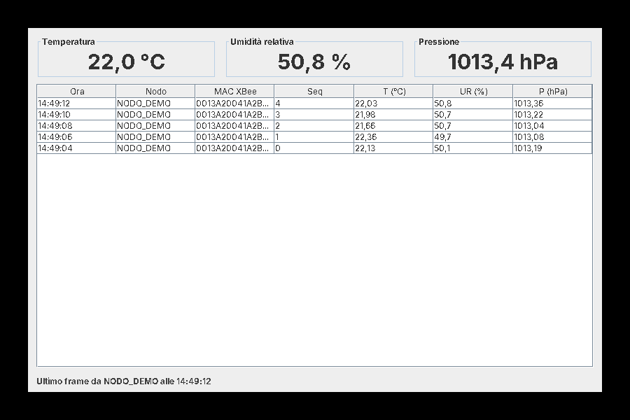

# waspmote_project_RAO_KHOUDMI_ZANGARI

Progetto di Wireless Networks: un nodo **Waspmote** misura temperatura, umidità
e pressione (sensore BME280) e invia i dati via **ZigBee (XBee PRO)** a un
gateway collegato al PC. Un'applicazione **Java** locale riceve i frame, li
decodifica e mostra i valori.

```
 Waspmote + BME280           XBee gateway (USB)              PC
┌──────────────────┐  ZigBee  ┌──────────────┐  seriale  ┌────────────────────┐
│ legge T, UR, P   │ ───────► │ coordinatore │ ────────► │ app Java (gateway/)│
│ crea frame ASCII │          │ API mode 2   │           │ decodifica e mostra│
└──────────────────┘          └──────────────┘           └────────────────────┘
```

## Struttura

```
firmware/
  sensore_bme280_zigbee/   sketch Waspmote (.pde) per il nodo sensore
  check.sh                 controllo sintattico degli sketch con avr-g++
gateway/                   applicazione Java (Maven)
  src/main/java/waspmote/gateway/
    xbee/                  decodifica dei frame XBee API (0x7E ..., escape, checksum, 0x90)
    frame/                 decodifica del frame Waspmote ASCII (<=> ... #TC:..#HUM:..#PRES:..#)
    source/                sorgenti dati: porta seriale reale o demo simulata
    ui/                    finestra Swing
    App.java               punto di ingresso e opzioni da riga di comando
  src/test/java/           test JUnit dei decoder
docs/                      immagini e documentazione
```

## Come arrivano i dati

I dati sono incapsulati su due livelli e l'app li "spacchetta" in ordine:

1. **Frame XBee API** (`xbee/XBeeApiDecoder`): `0x7E | lunghezza | tipo | dati | checksum`.
   Le librerie Libelium usano API mode 2 (AP=2), in cui i byte `0x7E 0x7D 0x11 0x13`
   sono preceduti da `0x7D` e messi in XOR con `0x20`.
2. **ZigBee Receive Packet 0x90** (`xbee/ZigBeeReceivePacket`): MAC a 64 bit del
   mittente, indirizzo di rete a 16 bit, opzioni, poi i dati applicativi.
3. **Frame Waspmote ASCII** (`frame/WaspmoteFrameParser`):
   `<=> | 0x86 | n. campi | #serial#ID nodo#sequenza#TC:24.31#HUM:51.2#PRES:101325.00#`

## Firmware

Si apre `firmware/sensore_bme280_zigbee/sensore_bme280_zigbee.pde` con la
**Waspmote PRO IDE** e si carica sulla scheda. Prima di caricarlo:

- impostare in `GATEWAY_MAC` l'indirizzo MAC a 64 bit dell'XBee del gateway;
- verificare la scheda sensori: lo sketch assume il BME280 sulla
  **Events Sensor Board v30**; con un'altra scheda vanno cambiati include e chiamate.

Controllo sintattico senza IDE (serve `gcc-avr` e le
[API Libelium](https://github.com/Libelium/waspmoteapi) in `$WASPMOTE_API`, default `/opt/waspmoteapi`):

```bash
./firmware/check.sh
```

## Applicazione Java

Requisiti: JDK 21 e Maven.

```bash
cd gateway
mvn package
```

Produce `gateway/target/gateway.jar`, eseguibile con tutte le dipendenze incluse.

```bash
java -jar target/gateway.jar --demo          # dati simulati, senza hardware
java -jar target/gateway.jar --list-ports    # elenca le porte seriali
java -jar target/gateway.jar --port COM3     # Windows (su Linux es. /dev/ttyUSB0)
```

Opzioni: `--baud 115200` (default), `--api1` se l'XBee del gateway è in API
mode 1, `--console` per stampare a terminale invece di aprire la finestra.



Note per l'uso con il gateway reale:

- l'XBee del gateway deve essere configurato come **coordinatore** in **API mode**
  (AP=2, oppure AP=1 con `--api1`), con lo stesso PAN ID del nodo;
- chiudere XCTU o il monitor seriale della IDE prima di avviare l'app, altrimenti
  la porta risulta occupata.

## Prossimi passi possibili

- salvare le letture su file CSV o in un piccolo database;
- grafici dell'andamento nel tempo;
- più nodi Waspmote e statistiche di rete (perdita di pacchetti dai numeri di sequenza, RSSI);
- supporto ai frame Waspmote binari.
